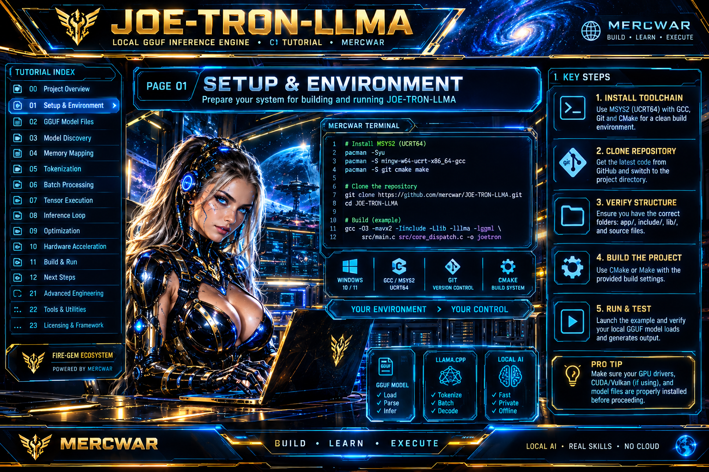

<div align="center">

  <!-- Gateway Banner -->
  <a target="_self" title="CLICK HERE to ENTER the GATEWAY FREE!" href="https://mercwar.github.io/Constellation/index.html">
    
  </a>

  <br />
<div align="left">
<h1>🎉️ JOE-TRON-LLMA </h1> <p>Joe Tron's Official Tutorial for creating LLM Applications</p></div>
  </div>
  
  <br />

  <!-- Nexus Graphic -->
  <a target="_self" title="CLICK HERE to ENTER NEXUS FREE!" href="https://cron.iblogger.com/NEXUS">
    
  </a>

#

  <h3>🏅️ Sovereign Tutorial & Runtime Engine for Building Low-Level LLM Applications</h3>
<div align="center">
  <p>
    <a href="https://opensource.org/licenses/MIT"></a>
    <a href="https://en.wikipedia.org/wiki/C_(programming_language)"></a>
    <a href="app/page-0.md"></a>
  </p>


  <p>
    📡️ <strong><a href="../README.md">Main Readme</a></strong>
    📦️ <strong><a href="../page-TOC.md">Main TOC</a></strong>
    👈️ <strong><a href="page-2.md">Previous Page</a></strong>
    👉 <strong><a href="page-4.md">Next Page</a></strong>
  </p>
  </div></div>
  
---
# Module 3: The Developer’s Workflow — Sourcing and Managing GGUF Files Manually

When you are building a custom runtime or a native Windows executable from scratch, relying on automatic desktop UI model fetchers isn't enough. As a systems developer, **you have to fetch, organize, and provision the `.gguf` file yourself** before your application can even attempt to memory-map it.

Here is how developers handle raw GGUF acquisition on Windows environments.

---

## 1. Direct Acquisition via the Hugging Face CLI (`huggingface-cli`)

Instead of writing custom HTTP download logic for your app's initial setup, you use the official Python toolkit to pull specific quant files straight from the terminal:

```bash
# Install the hub client via pip
pip install huggingface-hub

# Download a specific Q4_K_M GGUF file directly into your workspace root
huggingface-cli download bartowski/Llama-3-8B-Instruct-GGUF \
  --include "Llama-3-8B-Instruct-Q4_K_M.gguf" \
  --local-dir . \
  --local-dir-use-symlinks False

```

* **Why `--include` matters:** Hugging Face GGUF repos often list 10 to 20 different quantization flavors (`Q2_K`, `Q4_0`, `Q5_K_M`, `Q8_0`). Specifying the exact filename prevents downloading tens of gigabytes of redundant weights.

---

## 2. Converting PyTorch Safetensors to GGUF Yourself

Sometimes the exact model or custom fine-tune you want **does not have a pre-compiled GGUF variant**. As a developer, you have to build it yourself by converting raw Hugging Face `config.json`, tokenizer files, and `.safetensors` shards into a unified GGUF binary.

### Step A: Clone the Conversion Engine (`llama.cpp`)

```bash
git clone https://github.com/ggml-org/llama.cpp.git
cd llama.cpp
pip install -r requirements.txt

```

### Step B: Run the Python Conversion Script

Run the official conversion utility to package the raw shards into a master 16-bit float (`F16`) GGUF file:

```bash
python convert-hf-to-gguf.py path/to/raw-hf-model-folder \
  --outfile model-f16.gguf \
  --outtype f16

```

### Step C: Quantize to Lower Bit-Widths

Once you have the raw `model-f16.gguf`, use the compiled quantization utility (`llama-quantize.exe` on Windows) to shrink it down to a 4-bit or 5-bit variant for efficient local RAM usage:

```bash
llama-quantize.exe model-f16.gguf model-Q4_K_M.gguf Q4_K_M

```

---

## 3. Organizing Your Local Developer Storage Layout

When writing your C/C++ loader executable, hardcoding absolute paths (`C:\Users\Name\Desktop\model.gguf`) breaks portability. Professional low-level developers structure their project directory with a designated local assets folder:

```text
/my-llm-runtime/
│
├── bin/
│   └── runtime.exe          <-- Your compiled C win32 executable
│
├── models/
│   └── active_model.gguf    <-- Symlinked or copied local GGUF target
│
└── src/
    └── main.c               <-- Win32 mmap & parsing logic

```

In your application code, you point your `CreateFileA` mapping handle to a relative or config-defined path:

```c
#define MODEL_PATH "..\\models\\active_model.gguf"

// Opening the developer-provisioned file locally
HANDLE hFile = CreateFileA(
    MODEL_PATH, 
    GENERIC_READ, 
    FILE_SHARE_READ, 
    NULL, 
    OPEN_EXISTING, 
    FILE_ATTRIBUTE_NORMAL, 
    NULL
);

```

---

### What's next in the tutorial pipeline?

Now that the GGUF file is manually downloaded, quantized, and sitting in your project directory:

1. **Writing the C Header Parser:** Reading the 4-byte Magic Number (`0x46554747`), version, and tensor counts directly from the memory-mapped pointer.
2. **Parsing Metadata Key-Value Pairs:** Extracting context length, embedding dimensions, and layer counts programmatically in pure C.

Where should we dive into the code next?
<!-- Nexus Graphic -->
  <a target="_self" title="CLICK HERE to ENTER NEXUS FREE!" href="https://cron.iblogger.com/NEXUS">
    
  </a>
  
<div align="center">
  <p>
    📡️ <strong><a href="../README.md">Main Readme</a></strong>
    📦️ <strong><a href="../page-TOC.md">Main TOC</a></strong>
    👈️ <strong><a href="page-2.md">Previous Page</a></strong>
    👉 <strong><a href="page-4.md">Next Page</a></strong>
  </p>

</div>
